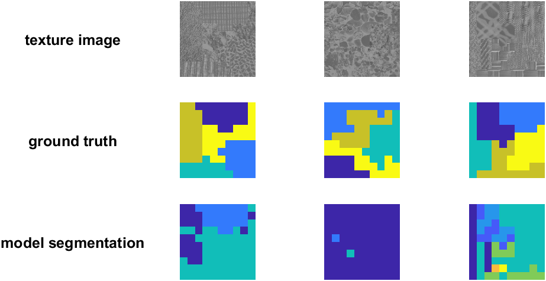

# texture-segmentation

Code for **"Principles of local and global grouping that underlie segmentation of natural texture images"** (W. S. Geisler & A. Das, [bioRxiv 2026](https://www.biorxiv.org/content/10.64898/2026.05.06.723304v1.abstract)) — the Bayesian model, the human psychophysics that tests it, and the texture-region stimuli both are run on.



## What it does

Given two patches of an image, is it the *same* texture or a *different* one? This repo builds a **Hierarchical Bayesian Observer (HBO)**: each low-level image statistic — the Fourier power spectrum, the gray-level histogram, the distribution of oriented edges, the energy along the border between the patches — contributes a log-likelihood ratio, and those *decision variables* are combined into one same/different judgement. Applying that judgement to every pair of patches in an image, and then grouping the patches that agree, **segments** the image into texture regions.

The same repo holds the **Psychtoolbox experiments** that measure human observers on exactly these tasks (discrimination of patch pairs, and grouping of patches in a texture-region image), so model and human can be compared on the same stimuli.

The sibling [texture-learning](https://github.com/Bill-Geisler/texture-learning) repo ([proximity paper](https://www.biorxiv.org/content/10.64898/2026.05.12.724620v1.abstract)) builds on this model, showing it can be *trained* from unlabelled natural images by using spatial proximity as a ground-truth proxy. The learned twin/Siamese-network comparison lives there too.

## Dependencies

- **[vislab-common](https://github.com/abhranildas/vislab-common)** — the lab's shared MATLAB library (the `+vislab` package inside the sibling `vislab-common` folder; `setup.m` clones it automatically if it's missing). Provides `vislab.lib.*` (optics, filters, normalization, downsampling), `vislab.nat_stat_bayes.*` (the decision-variable toolkit) and `vislab.psychframework.*` (the shared Psychtoolbox experiment harness).
- **[IntClassNorm](https://www.mathworks.com/matlabcentral/fileexchange/84973-integrate-and-classify-normal-distributions)** and **[gx2](https://www.mathworks.com/matlabcentral/fileexchange/85028-generalized-chi-square-distribution)** — MATLAB **add-on toolboxes** (`classify_normals`, `quad2fun`, `gx2*`). If either is missing, `setup.m` downloads the `.mltbx` from its latest GitHub release and installs it automatically (needs network); if that fails it opens the File Exchange page and warns.
- **vislab-common/data** — the shared data store, a sibling folder alongside this repo. Its **texture sheets** (Brodatz, Fabric, Pertex, VisTex, …) and colour transforms ship inside the `vislab-common` repo, so `setup.m`'s auto-clone brings them along, and that is all the quick demo needs. Only the large calibrated **natural-image** set (~19 GB), used by the demo's feature-prior panels and the `+general` analyses, is too large for GitHub and must be obtained separately. `setup.m` warns if the store is missing; edit `cfg.paths.data_root` if you keep it elsewhere.
- **[Psychtoolbox-3](http://psychtoolbox.org/)** — required only to *run* the human experiments (`+experiment`). Nothing else in the repo needs it.
- MATLAB with the Image Processing and Statistics & Machine Learning toolboxes.

## Installation and setup

- Download or git clone this repository to your local machine.
- Install git (so that the `setup` script can automatically git clone the `vislab-common` dependency).
- Within MATLAB, navigate to the repo folder and run:

```matlab
setup            % adds this repo + vislab to the path; auto-installs the gx2/IntClassNorm toolboxes if missing
cfg = config;    % data paths + shared constants; edit cfg.paths.data_root if vislab-common/data isn't a sibling
```

`setup` only changes the path for the current session, so re-run it in every new MATLAB session. It is safe to re-run: every step is a no-op once the thing it provides already resolves.

## Quick demo

```matlab
run_demo      % seven figures and a printed summary, in well under a minute
```

`run_demo.m` is a short, self-contained tour of the model and the published figures it reproduces. Most of it runs in seconds from the Brodatz texture sheets `setup` clones for you; one part additionally reads 40 of the sibling vislab-common repo's calibrated natural images (~50 MB each) for its color-pixel priors, which `setup` does **not** fetch automatically (see Dependencies above). The demo is fully reproducible — everything is drawn under `rng(cfg.seed)`, and every patch is given an explicit seed, so repeated runs give identical numbers and identical images.

It walks through seven things, each its own figure window:

1. **Grown texture regions** (paper Figure 1). Three images of five grown Brodatz texture regions — grown by letting a patch grid spread into contiguous regions (`grouping.mk_masks`), texturing each region (`grouping.mk_texs`, `lib.texture_patch`) — above their ground-truth region maps, above the model's **own** segmentation of each image. That third row runs the real grouping pipeline (`segment_scene`, defined once and reused at full-scene scale in part 6) directly on the image, so you can see the model's output next to the answer key.
2. **Feature-response priors** (paper Figure 5, panels A-F). The marginal pixel-value priors the model's decision variables are built from: LMS and ABR (achromatic/blue-yellow/red-green) histograms and ABR cumulative distributions, measured over real natural-image patches (A-C); and the steerable-filter magnitude/orientation, center-surround, and power cumulative distributions, measured over Brodatz patches instead (D-F), as in the sibling texture-learning repo's own feature priors.
3. **The optimal decision bound** (paper Figure 6A). The three published decision variables — power, spot, and edge — plotted against each other for 17,700 same- and 17,700 different-texture pairs (`data/model/all_cues.mat`), with the Bayes-optimal bound between them fitted and drawn by `classify_normals`.
4. **Forming the final decision variable.** Unpacks part 3's single 3D fit into the pieces the sibling texture-learning repo's own decision-variable-construction figures use: the response cloud with its boundary, each cue's proportional contribution to d′ (`classify_normals`' `d_con` output), and the resulting 1D separation of same- vs. different-texture pairs once power, spot, and edge combine into one number.
5. **Region-growing parameters** (paper Figure 9, five of its six panels). The same region-growing run at three region counts, two block sizes, and one partial-coverage, center-biased setting. The sixth panel needs a vertical orientation bias that nothing in this repo implements.
6. **Full-scene grouping** — the actual task the model performs, not a controlled comparison. Builds one 1024×1024 scene of 16 Brodatz regions, splits it into a 16×16 grid of patches, and runs the real grouping pipeline end to end: the power and histogram decision variables over every ordered pair of patches, combined by a fitted quadratic boundary (`data/model/brodatz_boundary.mat`) into one decision variable per pair, thresholded into links (`grouping.thresh`), and merged into regions by how many links each linked pair shares (`grouping.nlsame`). Shows the scene next to the region map the grouping found.
7. **Human discrimination accuracy vs. eccentricity** (paper Figure 6B, human data only). Real observers' same-different accuracy in the separated task, averaged across the subject files in `exp_files/sep/subject_out/` via `general.compute_exp_error_mat`. There's no model curve to compare it against yet — that needs an eccentricity-dependent model simulation this repo doesn't have (see Known issues below).

It deliberately does **not** launch the Psychtoolbox experiments (those need a live display and a subject) or any further `+general` natural-image analyses (those need the full ~19 GB image set) — see the README sections below for those.

## Repository layout

```
texture-segmentation/
├── setup.m, config.m     path bootstrap + central configuration
├── run_demo.m            the quick demo above
├── +lib/                 decision variables and patch tools (hist_dv, edge_props_stim,
│                           steerable_grad/filter, texture_patch, ...)
├── +grouping/            texture-region stimulus generation + grouping geometry
├── +experiment/          Psychtoolbox experiments: +discriminate and +grouping,
│                           each with +prep (session setup) and +run (trial loop),
│                           plus a shared +run for the hooks both experiments use
├── +general/             patch-pair generators, simulations, analysis functions
│                           (these are the parts that need the natural-image set)
├── data/                 model/ (fitted discrimination boundaries, model results)
│                           + stimuli/ (derived patch sets, git-ignored where large)
├── exp_files/            human-subject experiment settings and output
├── docs/                 repo-cleanup.md — the cleanup/refactor plan and bug register
├── notes/                papers, posters, and talk slides for the project
└── tools/                repo-maintenance checks (style check, golden-output harness)
```

The full-scene grouping demo (part 6 of `run_demo.m`) and the older analysis functions use decision variables that live in `+lib` (`re`, `rs`, `rs_new`, `edge_dv`, `mk_contour`) and `+grouping` (`mk_win`, `thresh`, `nlsame`).

`data/model/` holds fitted decision boundaries and model-evaluation results, none of them reproducible from the code in this repo (the fits predate it):

- `brodatz_boundary.mat` — the 2-cue (power, histogram) quadratic boundary `run_demo.m`'s part 6 loads, fitted on Brodatz scenes like the one it builds.
- `fabric_bd.mat` — the same shape of boundary, fitted on fabric textures instead; nothing in the repo loads it.
- `texture discrimination boundaries.mat` — the 4- and 9-cue boundaries `+general/simulate_discrimination.m` compares a simulated observer against.
- `all_cues.mat` — power/histogram/edge cue values and same/different labels for 17,700 Brodatz patch pairs, behind the published Figure 6A and `run_demo.m`'s parts 3-4.
- `acc_mod.mat` — two 6x4 model-accuracy tables (`acc_mod_train`, `acc_mod_gen`); not loaded by any code here.

Shared low-level code lives in `vislab` (not here), so it isn't duplicated across the lab's repos.

## Model pipeline

Unlike the sibling texture-learning repo, nothing here is *trained* — the decision variables are closed-form statistics of the patches (no learned priors or bin boundaries to fit), and the boundaries combining them (`data/model/*.mat`) were fitted once, outside this repo, against the human data. The model pipeline is a single pass, applied either to a pair of patches (discrimination) or to every patch pair in a scene (segmentation):

| Step | Code | Produces |
|---|---|---|
| Decision variables | `vislab.nat_stat_bayes.dv_power`, `lib.hist_dv`, `vislab.nat_stat_bayes.dv_edge_hist`, `vislab.nat_stat_bayes.dv_border` | one log-likelihood ratio per low-level cue (power, spot/histogram, edge, border), for a pair of patches |
| Combination | `classify_normals` / `quad2fun` on `data/model/*.mat` | the cues combined into one same/different decision variable, via a fitted quadratic bound |
| Linking | `grouping.thresh` | which patch pairs' combined DV clears the link criterion |
| Merging | `grouping.nlsame` | linked patches merged into regions by shared-link fraction |

`run_demo.m`'s `segment_scene` (used by both parts 1 and 6) is this whole pipeline end to end, on one square gray-level scene. The psychophysics in `+experiment` measures the same discrimination and grouping judgements in human observers, on the same kind of stimuli `+grouping` builds.

## Known issues

The repo is mid-way through a documented cleanup (see Documentation below; `docs/repo-cleanup.md` section 0.4 is the full bug register). Three things a new user will notice:

- **The Psychtoolbox experiments do not currently launch.** Both `+experiment` trees read an `exp_settings.monitorSizePix` field that nothing in the repo ever assigns (bug B2.10), and the `+grouping` tree has several further gaps behind it (B2.8, B2.9, B2.16). The stimulus generation and analysis code around them is fine; it is the session-setup plumbing that is incomplete.
- **Three higher-level `+grouping` stimulus functions are still broken** — `demo_mk_trl_points` errors on its first line (bug B2.5), `s_gtr_img` never assigns its output (B3.11), and `mk_texseg_stim_points` renders only the first contrast block of a session (B2.7). The **low-level** `+grouping` helpers they build on are verified working and covered by the golden-output harness in `tools/` — `run_demo.m` composes a texture-region stimulus out of them directly.
- **Manuscript Figures 6B-D, 7, and 8 aren't reproduced** (`docs/repo-cleanup.md` section 0.7 is the full register). The demo rebuilds the human half of 6B only; the model-overlay and joined-task halves need an eccentricity-dependent model simulation and a joined-task decision boundary that don't exist yet, and Figure 7 needs a trial-by-trial correlation analysis that doesn't exist either. None of this is a broken-code bug — it's missing entry points, scoped but not built.

Everything the quick demo touches runs.

## Documentation

- `docs/repo-cleanup.md` — the cleanup plan: conventions, the stage-by-stage log, and the register of known bugs and structural issues. Stages 1 (style) and 2 (hygiene) are done; Stages 3 (organize) and 4 (bugs) are provisionally done (every 🔴-severity item fixed; some 🟠/🟡 ones remain, listed above); Stages 5 (speed) and 6 (closing) haven't started. `docs/repo-cleanup-texture-segmentation.html` is a rendered snapshot of an earlier version of the same plan.
- `../vislab-common/ARCHITECTURE.md` — how the repos, the shared library, the add-on toolboxes and `vislab-common/data` fit together.
- `notes/` — the papers, posters and slides behind the project, including the manuscript itself (`Texture paper biorxiv.pdf`) and its revision history.
- `CITATION.cff` — machine-readable citation metadata for both the software and the paper.

## License & citation

Code released under the MIT License (see `LICENSE`). If you use it, please cite the paper above (`CITATION.cff`).
